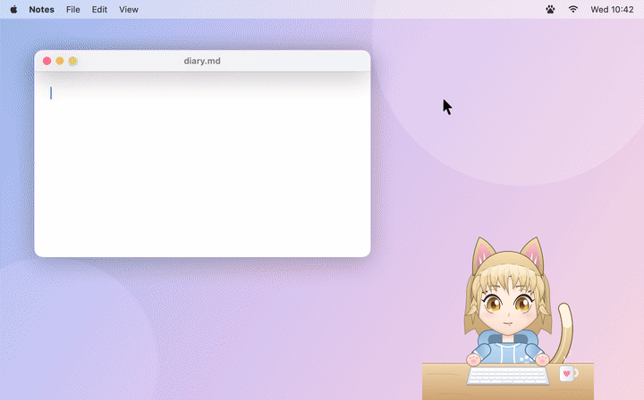

# Bongo Waifu

A Bongo Cat–style desktop companion for macOS. An anime girl sits on your desktop behind a tiny keyboard and taps along as you type. She changes expression, falls asleep when you stop, and pops up speech bubbles with comments and fun facts.



(Higher quality: [docs/demo-mochi.mp4](docs/demo-mochi.mp4) · Rin: [docs/demo-rin.mp4](docs/demo-rin.mp4))

The built-in characters are rigged like VTuber models:

- Their head and eyes follow your cursor.
- Layers shift with depth as the head turns.
- Hair, ears, ahoge and tail move with spring physics.
- They blink, ease between expressions, glance at the keyboard while you type, and lip-sync while talking.

## Build & run

```sh
./build.sh
open build/BongoWaifu.app
```

You need macOS 14+ and the Xcode Command Line Tools. The app lives in the menu bar (paw icon) and has no Dock icon.

**Accessibility permission:** macOS requires it to see global key presses. Grant it in System Settings → Privacy & Security → Accessibility. The app picks it up within a couple of seconds, with no relaunch needed. Ad-hoc–signed rebuilds can make macOS forget the grant. To keep it across rebuilds, toggle it off and on again, or build with a real certificate: `SIGN_IDENTITY="Apple Development: …" ./build.sh`.

**Privacy:** only the *kind* of key is used (Backspace / Enter / other) plus timing. Typed characters are never read, stored, or sent anywhere. Everything is offline.

## Using it

- **Drag** her anywhere. Her position is remembered.
- **Click** her for headpats. **Click the bubble** to dismiss it.
- **Right-click** her, or use the menu-bar paw, for:
  - Character
  - Size
  - Chattiness (Silent / Quiet / Normal / Chatty)
  - Fun Facts
  - Click-Through
  - Hide
  - Reset Position
  - Launch at Login
  - typing stats
- Transparent areas of the window never block clicks.

## Characters

| | Personality |
|---|---|
| **Sakura** | Genki cheerleader: pink hair, sailor uniform, ahoge |
| **Yuki** | Deadpan kuudere: silver bob, delivers trivia like a librarian |
| **Rin** | Tsundere gamer: red twin-tails, *n-not* impressed |
| **Mochi** | Sleepy catgirl: ears, tail, purrs at headpats |

She reacts to:

- typing speed
- streaks (100 / 250 / 500 / 1000+ keys)
- Backspace sprees
- Enter mashing
- going idle (she falls asleep) and coming back
- late-night sessions
- headpats

She also shares fun facts now and then while you type.

## Custom characters

Drop a folder into `~/Library/Application Support/BongoWaifu/Characters/` (menu → *Open Characters Folder…*), then choose *Reload Characters*.

```
MyWaifu/
  character.json      required
  idle.png            required: paws up
  left.png right.png  left / right paw down (fall back to idle)
  both.png            both paws (Enter, mouse clicks)
  sleep.png  blink.png
  expr_happy.png expr_excited.png expr_surprised.png expr_annoyed.png
  expr_sleepy.png expr_smug.png expr_blush.png
```

Frames are square-ish, bottom-aligned images (480×480 works well). `character.json`:

```json
{
  "name": "My Waifu",
  "tagline": "Custom character",
  "accent": "#E85A93",
  "bubble": "#FFFFFF",
  "scale": 1.0,
  "funFactIntros": ["Fun fact!"],
  "lines": {
    "greeting": ["Hi!"],
    "petted": ["Ehehe~"]
  }
}
```

Line categories:

- `greeting`
- `encouragement`
- `fast`
- `streak100`
- `streak500`
- `streak1000`
- `backspaceSpree`
- `enterSpam`
- `idle`
- `wakeUp`
- `lateNight`
- `petted`
- `funFact`

Any category you leave out falls back to a generic set.

`Examples/ExamplePack` is a complete pack you can copy and paint over. To export any built-in as a fresh template:

```sh
.build/release/BongoWaifu --export-pack ~/Desktop/MyPack
```

## Development

```sh
swift test                                       # typing stats + reaction engine
swift run BongoWaifu --render-previews previews  # contact sheets of every character/mood
swift run BongoWaifu --record-demo frames builtin.mochi  # scripted demo → PNG frames + frames.txt
ffmpeg -f concat -safe 0 -i frames/frames.txt -vf fps=30,format=yuv420p demo.mp4
```

The demo recorder plays a seeded, scripted session (`DEMO_SEED` changes which lines she picks) against the real model and views. It renders offscreen, so it needs no Screen Recording permission.

- `Sources/WaifuCore`: pure logic (`TypingStats`, `ReactionEngine`, line banks, fun facts)
- `Sources/BongoWaifu`: AppKit/SwiftUI app (overlay window, input monitor, menu, vector + sprite renderers)
